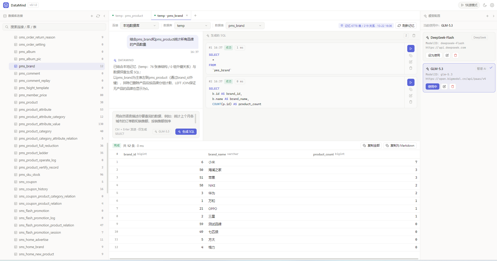
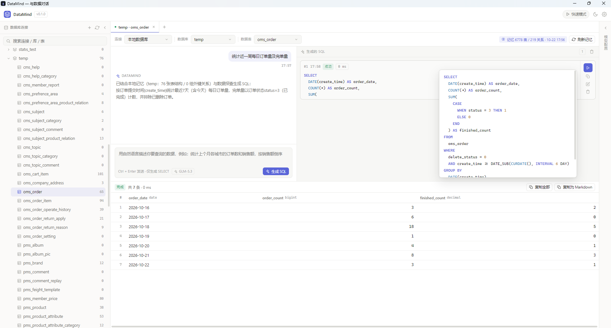
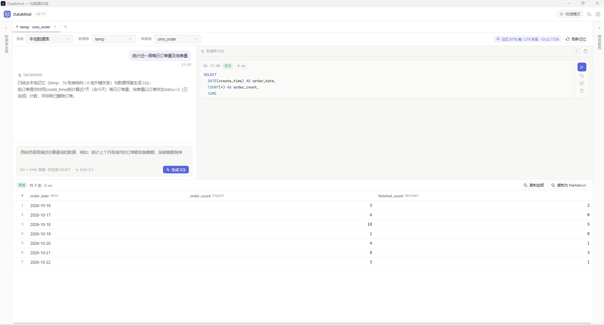

<div align="center">

# DataMind

**与数据对话** — 自然语言查询数据库的桌面客户端

用一句话描述你要的数据，DataMind 结合数据库结构记忆生成 SQL 并直接执行。  
基于 Tauri 2 构建，单文件约 10 MB，数据不出本机。


</div>

---

## 界面预览

| 自然语言取数 |
| ------ | 
|  |

| SQL 卡片与全文查看 |
| ----------- |
|  |

| 快速模式 |
| ---- |
|  |

## 它是什么

**DataMind 让每个人都能用更简单的方式了解数据**：

1. 把 MySQL 连接交给 DataMind，它会自动读取所有库表的 **DDL、列注释、外键关系与取样数据**，建立一份本地「结构记忆」；
2. 用自然语言提问（例如 *统计近 7 天每日订单量与完结量*），DataMind 将问题与结构记忆一起交给大模型，生成 SQL 并直接执行；
3. 结果以表格呈现，可多选、复制为文本 / Markdown，全过程 SQL 留痕可查。

模型调用走你自己的 API Key（DeepSeek / 智谱 / 任意 OpenAI 兼容接口），数据库凭据只保存在本机 —— **没有任何中间服务器**。

## 功能与特性

### 数据库连接

- **连接管理**：多连接树形管理，按「库 / 表」浏览，展示表行数与注释
- **SSH 隧道**：密码 / 私钥两种认证，安全访问内网数据库（纯 Rust SSH 实现）
- **双击预览**：双击数据表自动创建查询窗口并查询整表，结果完整返回（界面分页展示，单页最多 1000 行）
- **自动重连**：TCP keepalive + 连接池 TTL + 心跳检测，断连自动重建（含 SSH 隧道）

### 自然语言生成 SQL

- **快速模式**：单次生成，响应快，适合简单查询
- **Agent 模式**：五阶段流水线 —— Schema 分析 → 数据探查 → SQL 设计 → 生成 → 校验（AST 检查 + EXPLAIN + 模型复审），适合跨表 JOIN、聚合统计等复杂问题
- **结构记忆**：本地缓存库表结构作为模型上下文，使生成的 SQL 贴合真实字段与注释
- **多轮上下文**：结果不对可以继续补充描述，模型结合历史对话与上一轮 SQL 增量迭代，而不是推倒重来
- **智能修复**：SQL 执行报错时，一键将错误信息回传模型修正
- **手写 / 粘贴 SQL**：「新建 SQL」直接手写或粘贴 SELECT 执行，与生成的 SQL 同一条执行与校验链路

### 安全与执行保护

- **只读硬约束**：所有 SQL 经 AST 解析，仅放行 `SELECT`，写操作在前后端双重拦截
- **超时与取消**：默认 60s 自动取消，支持手动中止
- **结果集不截断**：SQL 原样下发（不自动追加 `LIMIT`），结果完整返回
- **凭据本地存储**：连接与模型配置仅保存在本机应用数据目录

### 结果与体验

- **SQL 卡片**：格式化 + 语法高亮、弹窗编辑、悬浮查看全文、一键复制
- **结果集操作**：自适应列宽 + 手动拖拽、多单元格 / 整行选择、右键复制为 TSV 或 Markdown 表格
- **大结果集分页**：结果超过单页行数时右下角出现分页条，单页最多 1000 行（可切 100 / 200 / 500 / 1000），行号与跨页选中均为全局连续编号
- **结果导出**：一键导出为 Excel（含「字段说明」表保留数据类型）或 JSON（数值 / NULL 保留原始形态），内容与界面展示完全一致
- **三栏可拖拽布局**：左右栏可折叠，中间区域多级分割自由调整
- **深色 / 浅色主题**、多查询窗口 Tab、SQL 执行日志全程留痕
- **健壮性**：WebView2 崩溃自动重建窗口、第三方输入法冲突预警、中文乱码自动修复（GBK / cp1252 / 二次编码还原）

## 技术栈

| 层      | 技术                                          | 说明                                              |
| ------ | ------------------------------------------- | ----------------------------------------------- |
| 壳 / 后端 | **Rust + Tauri 2**                          | 体积小（约 10 MB）、内存占用低，同一代码库可拓展 macOS / Linux / 移动端 |
| 数据库驱动  | **mysql_async**（rustls）                     | 纯 Rust MySQL 驱动，连接池管理，无 OpenSSL 依赖              |
| SSH 隧道 | **russh**                                   | 纯 Rust SSH 协议栈，本地端口转发                           |
| SQL 守卫 | **sqlparser-rs**                            | AST 级只读保护与 SQL 校验                               |
| 编码修复   | **encoding_rs**                             | GBK / BIG5 / cp1252 解码与乱码还原                     |
| 模型协议   | **reqwest** + OpenAI 兼容 `/chat/completions` | 支持 DeepSeek、智谱及任意自定义端点                          |
| 前端     | **Vue 3 + TypeScript + Vite**               | 组合式 API，无重型 UI 框架依赖                             |

## 项目结构

```
├── docs/screenshots/     # 界面截图
├── src/                  # 前端（Vue 3 + TS）
│   ├── components/       # 三栏布局 / 查询视图 / 结果表格 / 各弹窗
│   ├── composables/      # 全局状态、后端调用封装、UI 基建
│   ├── lib/              # SQL 格式化高亮、Tauri invoke 封装
│   └── styles/           # 设计令牌（Linear / Termius 风格）
└── src-tauri/            # 后端（Rust）
    ├── src/
    │   ├── commands.rs   # Tauri 命令层（前端 invoke 入口）
    │   ├── mysql.rs      # 连接池 / 结构内省 / 只读执行 / 超时取消 / 字符集修复
    │   ├── agent.rs      # Agent 模式五阶段流水线
    │   ├── tunnel.rs     # SSH 隧道（russh 端口转发）
    │   ├── guard.rs      # SELECT-only AST 校验 + 安全 LIMIT
    │   ├── llm.rs        # OpenAI 兼容模型调用 / Prompt 构造（含多轮上下文）
    │   ├── export.rs     # 结果集导出（Excel xlsx / JSON）
    │   ├── watchdog.rs   # WebView2 崩溃守护
    │   └── store.rs      # 本地持久化（连接 / 模型 / 设置 / 记忆 / 日志）
    └── examples/         # 只读诊断工具（字符集 / DDL 排查）
```

## 适用场景

- **业务取数**：运营 / 产品同学用一句话拿到统计数据（如「统计上个月各城市的订单销售额，按倒序排列」），不必等排期写 SQL
- **开发排查**：快速查看线上库表结构、注释与抽样数据，配合 SSH 隧道安全访问内网环境
- **数据探索**：接手陌生业务库时，用结构记忆 + Agent 模式梳理表关系、验证字段含义
- **临时统计**：替代「打开数据库工具 → 手写 JOIN → 导出」的重复流程，结果一键复制为 Markdown表格
- **NL2SQL**：完整的「结构召回 → 探查 → 生成 → 校验」流水线

## 安装与使用

### 方式一：下载安装包（推荐）

前往 [Releases](../../releases) 下载最新的 `DataMind_x64-setup.exe`（NSIS 安装包）或绿色版 `DataMind.exe`，双击运行即可。  
需要 [WebView2 Runtime](https://developer.microsoft.com/microsoft-edge/webview2/)（Windows 11 / 更新过的 Win10 已内置，安装包亦可自动引导下载）。

### 方式二：源码构建

**环境要求**：Node.js 18+、Rust 1.77+（Windows 需安装 Visual Studio Build Tools 的 C++ 工作负载）、WebView2 Runtime

```bash
git clone https://github.com/your-github-name/DataMind.git
cd DataMind
npm install

npm run tauri:dev     # 开发模式（前端热更新）
npm run tauri:build   # 打包发布版 exe + NSIS 安装包
```

**一键打包并运行**：项目根目录的 `build-and-run.bat`，双击即可依次完成「拉取最新代码 → 打包 → 启动应用」。
（文件为 GBK + CRLF 编码，请勿转成 UTF-8，否则 cmd 解析会错位。）

```bat
build-and-run.bat              :: 拉取最新代码 + 打包 + 启动应用
build-and-run.bat --skip-pull  :: 跳过 git pull，用本地代码打包
build-and-run.bat --installer  :: 打包后运行 NSIS 安装程序（而非直接启动 exe）
```

构建产物：

```
src-tauri/target/release/DataMind.exe          # 单文件可直接运行
src-tauri/target/release/bundle/nsis/*.exe     # NSIS 安装包
```

> **注意**：发行构建必须启用 `custom-protocol` feature（前端资源才会随 exe 内嵌）。  
> `npm run tauri:build` 会自动加上；若直接用 cargo 构建，请执行  
> `cargo build --release --features custom-protocol`（或 `npm run build:exe`），  
> 否则 exe 会尝试加载开发服务器地址导致白屏。

纯前端调试（不连数据库）：`npm run dev`。

### 首次使用

1. 右上角 **模型配置** → 选择 DeepSeek / 智谱预设，或自定义任意 OpenAI 兼容端点，填入 API Key；
2. 左上角 **新建连接** → 填写 MySQL 主机 / 端口 / 账号（内网库可开启 SSH 隧道）；
3. 点击连接的 **刷新结构记忆**，等待库表结构采集完成；
4. 顶部切换 **快速模式 / Agent 模式**，在输入框用自然语言提问，回车即可。

## 安全说明

- **数据库只读**：所有 SQL 经 AST 解析，仅放行 `SELECT`；写操作在前后端双重拦截。
- **凭据存储**：`connections.json` / `models.json` 以明文保存在本机应用数据目录（`%APPDATA%/com.datamind.app`），单机工具可接受；后续版本计划接入系统凭据库（Windows Credential Manager / Keychain）。
- **SSH 主机密钥**：当前信任所有主机密钥（等同 `ssh -o StrictHostKeyChecking=no`），后续版本增加指纹确认。
- **模型调用**：提示词中会包含库表结构（DDL / 注释 / 抽样），请确保你使用的模型服务条款允许传输这些内容；敏感库建议使用本地部署模型。

## 贡献

欢迎 Issue 与 PR。提交前请运行：

```bash
npm run build                # 前端类型检查 + 构建
cd src-tauri && cargo test   # 后端单测
```

## License

[MIT](LICENSE)
